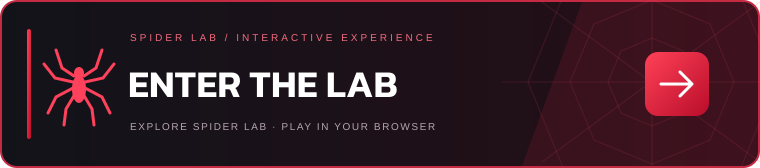

<div align="center">


[ภาษาไทย](README.md) · **English**

# 🕷️ SPIDER LAB · The Invention Archive

**Behind every mask is an extraordinary mind.**

Explore Spider-Man's inventions across three cinematic eras, in interactive 3D.

<a href="https://ampsoria.github.io/Spider-Lab/?lang=en">
  
</a>

[](https://github.com/Ampsoria)


[The archive](#archive) · [Quick start](#quick-start) · [Deployment](#deploy) · [Credits](#credits)

</div>

---

<a id="archive"></a>

## 🕸️ THE ARCHIVE

A red-and-black Spider-Man fan project. Open Peter Parker's research archive and discover the gadgets, inventions, and powers behind the films.

| 🕷️ THE ORIGINAL | 🕸️ THE AMAZING | 🔴 THE NEXT GENERATION |
| :---: | :---: | :---: |
| **Tobey Maguire** | **Andrew Garfield** | **Tom Holland** |
| Classic mask · Organic webbing · Camera | Web shooter · Web cartridge · Amazing mask | Spider Tracker · Web shooter · Spider Drone |

### Inside the lab

| System | What you can do |
| --- | --- |
| 🧬 **3D Invention Viewer** | Rotate, zoom, reset, and explore exploded views across 9 exhibits. |
| 📡 **Spider Tracker** | Choose from 3 fictional targets and scan simulated signals. |
| 🎬 **Immersive Mode** | Enter fullscreen view and optionally enable sound effects. |
| 📱 **Friendly Neighborhood UI** | Mobile layouts, reduced motion support, and a fallback when WebGL is unavailable. |
| 🌐 **TH / EN** | Switch between Thai and English. Your language preference is remembered. |

> **Ready to explore:** The main app is static. No database, account, or API key required.

---

<a id="quick-start"></a>

## ⚡ QUICK START

Use **Node.js 22.13 or later**. Node.js 22 is recommended and specified in `.nvmrc`; run `nvm use` first if you use nvm.

```bash
npm ci
npm run dev
```

Open the URL printed in your terminal, normally `http://localhost:5173`. Vite picks another port if it is already in use.

Use the **TH / EN** buttons in the header to switch languages. Add `?lang=en` to a URL to share the English version directly. The app uses self-hosted **Kanit** fonts, with no Google Fonts request.

## 🧪 LAB CHECKS

```bash
npm run lint
npm run typecheck
npm test
npm run preview
```

`npm test` creates the production build in `dist-static/`, verifies the HTML entry and linked assets, and checks translation coverage. These checks do not validate WebGL rendering or every browser interaction.

`npm run preview` serves the production build, normally at `http://localhost:4173`. Build first with `npm run build`, or use `npm test`. `npm start` is also a preview command.

<a id="deploy"></a>

## 🚀 DEPLOY

### GitHub Pages

1. Push the project to the `main` branch of your GitHub repository. Keep `node_modules/` and `dist-static/` out of Git.
2. In **Settings → Pages → Build and deployment → Source**, select **GitHub Actions**.
3. Push a commit, or open **Actions → Check and deploy GitHub Pages → Run workflow**.
4. Once deployment succeeds, open the `github-pages` environment URL. For this repository: **https://ampsoria.github.io/Spider-Lab/**.

The workflow at `.github/workflows/pages.yml` checks lint, TypeScript, and the production build before deploying pushes to `main`. Pull requests are checked without deployment. Update `branches: [main]` if your default branch uses another name.

Relative asset URLs support both repository subpaths and root domains.

### Vercel / Netlify

The included configs use these settings:

| Setting | Value |
| --- | --- |
| Build command | `npm run build` |
| Output directory | `dist-static` |
| Node.js | `22` |

The earlier `dev:static`, `build:static`, and `preview:static` commands remain available.

## 🗂️ BLUEPRINT

| File | Purpose |
| --- | --- |
| `index.html` | Initial language, metadata, and static HTML entry |
| `static/main.tsx` | React entry and global styles |
| `app/page.tsx` | Archive content, hero selection, and viewer controls |
| `app/globals.css` | Theme, fonts, and responsive layouts |
| `app/components/GadgetScene.tsx` | Three.js geometry and camera |
| `app/components/TrackerSimulator.tsx` | Simulated tracking interface |
| `app/i18n/LanguageProvider.tsx` | Language preference, URL selection, and page metadata |
| `app/i18n/en.json` | English translations of Thai content |
| `vite.static.config.ts` | Local development and static build config |
| `.github/workflows/pages.yml` | Project checks and GitHub Pages deployment |

`next.config.ts` and `app/layout.tsx` belong to the original vinext/Sites mode. Edit `index.html` for initial static metadata and `LanguageProvider.tsx` for localized metadata.

<details>
<summary><strong>☁️ Original Cloudflare / Sites mode</strong></summary>

The original server configuration is preserved and available separately:

```bash
npm run dev:sites
npm run build:sites
npm run test:sites
npm run start:sites
```

This mode uses vinext, Wrangler, the native `workerd` binary, and `.openai/hosting.json`. If native binaries stop working after moving the project between machines, run `npm ci` on the destination machine. The default static mode does not require Cloudflare.

</details>

---

<a id="credits"></a>

## ❤️ CREDITS

Designed and developed by **[Ampsoria](https://github.com/Ampsoria)**, inspired by Spider-Man and Peter Parker's inventions.

Exhibit models are built from geometry in code and creatively interpret the films. They are not official assets or engineering plans. Tobey's webbing is a biological power; some of Tom's gadgets were developed by Tony Stark. The tracker uses fictional data, with no GPS access or real-world tracking.

Typography: **Kanit**, by the Kanit Project Authors, distributed through Fontsource under the SIL Open Font License.

Spider-Man and related characters belong to Marvel / Sony Pictures. This is an independent fan project for learning and experimentation, with no official affiliation.

<div align="center">

🕷️ **3 heroes · 9 exhibits · One legacy**

[Enter the lab →](https://ampsoria.github.io/Spider-Lab/?lang=en)

</div>
