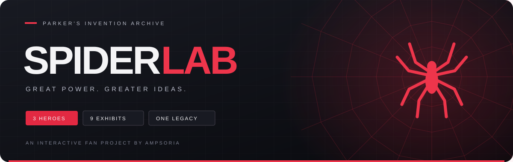

<div align="center">



# 🕷️ SPIDER LAB · ห้องแล็บแมงมุม

**เบื้องหลังหน้ากาก คือความคิดที่ไม่ธรรมดา**

สำรวจสิ่งประดิษฐ์ของ Spider-Man ทั้ง 3 ยุค ผ่านโลกสามมิติที่คุณควบคุมได้

[](https://ampsoria.github.io/Spider-Lab/)
[](https://github.com/Ampsoria)


[สำรวจคลัง](#-the-archive) · [เปิดเล่นในเครื่อง](#-quick-start) · [เผยแพร่เว็บ](#-deploy) · [เครดิต](#-credits)

</div>

---

## 🕸️ THE ARCHIVE

ห้องแล็บแฟนโปรเจกต์ธีมดำ–แดง รวบรวมอุปกรณ์และพลังจาก Spider-Man บนจอภาพยนตร์ ให้ลองสำรวจเหมือนกำลังเปิดแฟ้มงานวิจัยของ Peter Parker

| 🕷️ THE ORIGINAL | 🕸️ THE AMAZING | 🔴 THE NEXT GENERATION |
| :---: | :---: | :---: |
| **Tobey Maguire** | **Andrew Garfield** | **Tom Holland** |
| หน้ากากคลาสสิก · ใยชีวภาพ · กล้อง | เครื่องยิงใย · ตลับใย · หน้ากากอเมซิง | เครื่องติดตาม · เครื่องยิงใย · โดรนแมงมุม |

### สิ่งที่รออยู่ในแล็บ

| ระบบ | ลองทำอะไรได้บ้าง |
| --- | --- |
| 🧬 **3D Invention Viewer** | สำรวจ 9 ชิ้นจัดแสดง หมุน ซูม รีเซ็ต และแยกชิ้นส่วนโมเดล |
| 📡 **Spider Tracker** | เลือกเป้าหมายสมมติ 3 รายการ แล้วทดลองสแกนสัญญาณ |
| 🎬 **Immersive Mode** | เปิดมุมมองเต็มจอ พร้อมเสียงเอฟเฟกต์ที่เปิดเองได้ |
| 📱 **Friendly Neighborhood UI** | รองรับมือถือ การลดภาพเคลื่อนไหว และหน้าสำรองเมื่อ WebGL ใช้งานไม่ได้ |

> **แล็บพร้อมใช้:** เว็บหลักเป็น Static ไม่ต้องมีฐานข้อมูล บัญชีผู้ใช้ หรือ API key

---

## ⚡ QUICK START

ใช้ Node.js **22.13 ขึ้นไป** แนะนำ Node.js 22 ตามไฟล์ `.nvmrc`

```bash
npm ci
npm run dev
```

เปิด URL ที่ terminal แสดง ปกติคือ `http://localhost:5173` หากพอร์ตถูกใช้ Vite จะเลือกพอร์ตถัดไป

หากใช้ nvm ให้รัน `nvm use` ก่อนติดตั้ง dependencies

## 🧪 LAB CHECKS

```bash
npm run lint
npm run typecheck
npm test
npm run preview
```

`npm test` สร้าง production build ใน `dist-static/` และตรวจว่า HTML, JavaScript, CSS และ favicon มีอยู่จริง พร้อมใช้ asset URL ที่รองรับ subpath ของ GitHub Pages การทดสอบนี้ไม่ได้ตรวจภาพ WebGL หรือทุกปฏิสัมพันธ์ในเบราว์เซอร์

`npm run preview` เปิดดู production build ปกติที่ `http://localhost:4173` ต้อง build ก่อน สามารถใช้ `npm run build` เพื่อ build อย่างเดียว หรือ `npm start` เพื่อ preview ได้เช่นกัน

## 🚀 DEPLOY

1. สร้าง repository บน GitHub แล้ว push โค้ดทั้งหมดที่ต้องการแชร์ โดยใช้ branch `main` (ไม่ต้องอัปโหลด `node_modules/` หรือ `dist-static/`)
2. ไปที่ **Settings → Pages → Build and deployment → Source** เลือก **GitHub Actions**
3. ไปที่ **Actions → Check and deploy GitHub Pages → Run workflow** หรือ push commit ใหม่เข้า `main`
4. เมื่อ workflow ผ่าน เปิดลิงก์จาก deployment ของ environment `github-pages` โดยทั่วไปคือ `https://<username>.github.io/<repository>/`

Workflow ใน `.github/workflows/pages.yml` ตรวจ lint, TypeScript และ production build ก่อน deploy ทุกครั้งที่ push เข้า `main` ส่วน pull request จะตรวจโดยไม่ deploy หากใช้ชื่อ default branch อื่น ให้แก้ `branches: [main]` ใน workflow

Asset URLs เป็น relative จึงรองรับทั้ง GitHub Pages แบบ repository path และโดเมนหลัก

### Vercel / Netlify

เชื่อม repository กับโฮสต์ได้โดยใช้ config ที่มีให้แล้ว:

| การตั้งค่า | ค่า |
| --- | --- |
| Build command | `npm run build` |
| Output directory | `dist-static` |
| Node.js | `22` |

คำสั่ง `dev:static`, `build:static` และ `preview:static` ยังใช้ได้สำหรับผู้ที่เคยใช้เวอร์ชันก่อนหน้า

## 🗂️ BLUEPRINT

| ไฟล์ | หน้าที่ |
| --- | --- |
| `index.html` | ภาษา ชื่อเว็บ metadata และจุดเริ่มต้นของ Static app |
| `static/main.tsx` | โหลด React และ stylesheet |
| `app/page.tsx` | เนื้อหา การเลือก Spider-Man และส่วนควบคุม |
| `app/globals.css` | ธีมและหน้าจอมือถือ |
| `app/components/GadgetScene.tsx` | โมเดล Three.js และกล้อง |
| `app/components/TrackerSimulator.tsx` | เครื่องติดตามจำลอง |
| `vite.static.config.ts` | config หลักสำหรับ local และ Static deployment |
| `.github/workflows/pages.yml` | ตรวจโปรเจกต์และ deploy GitHub Pages |

`next.config.ts` และ `app/layout.tsx` ใช้กับโหมด vinext/Sites เดิม การแก้ title หรือ metadata ของเว็บ Static ให้แก้ `index.html`

<details>
<summary><strong>☁️ โหมดเดิมสำหรับ Cloudflare / Sites</strong></summary>


เก็บ config และไฟล์ฝั่งเซิร์ฟเวอร์เดิมไว้ สามารถเรียกแยกได้:

```bash
npm run dev:sites
npm run build:sites
npm run test:sites
npm run start:sites
```

โหมดนี้ใช้ vinext, Wrangler และ native binary ของ `workerd` รวมถึง config ใน `.openai/hosting.json` หากเจอปัญหา binary หลังย้ายเครื่อง ให้ติดตั้ง dependencies ใหม่ด้วย `npm ci` บนเครื่องปลายทาง โหมด Static ปกติไม่ต้องใช้ Cloudflare

</details>

---

## ❤️ CREDITS

ออกแบบและพัฒนาโดย **[Ampsoria](https://github.com/Ampsoria)** — สร้างขึ้นด้วยความชอบในโลกของ Spider-Man และสิ่งประดิษฐ์ของ Peter Parker


โมเดลที่แสดงในฉากสร้างจาก geometry ในโค้ด เป็นงานตีความที่ได้แรงบันดาลใจจากภาพยนตร์ ไม่ใช่ไฟล์หรือแบบกลไกทางการ ใยของ Tobey เป็นพลังชีวภาพ ส่วนอุปกรณ์ของ Tom บางรายการพัฒนาโดย Tony Stark ระบบ Tracker ใช้ข้อมูลสมมติ ไม่มี GPS หรือการติดตามบุคคลจริง

Spider-Man และตัวละครเป็นของ Marvel / Sony Pictures เว็บนี้เป็นแฟนโปรเจกต์อิสระสำหรับศึกษาและทดลอง ไม่มีความเกี่ยวข้องอย่างเป็นทางการกับเจ้าของผลงาน


<div align="center">

🕷️ **3 ฮีโร่ · 9 ชิ้นจัดแสดง · ตำนานเดียวกัน**

[กลับเข้าแล็บ →](https://ampsoria.github.io/Spider-Lab/)

</div>
